# ไร่ล้านนา (Farm Game)

เกมจำลองชีวิตเกษตรกรไทย 2 มิติ เล่นบนเว็บเบราว์เซอร์ สร้างด้วย Phaser 4 + TypeScript + Vite
ปลูกผัก ทำสวน ตกปลา ขุดแร่ เลี้ยงสัตว์ ไปกาด ไปงานบุญ เป็นเกมของเราเอง ในแนวเกมฟาร์มคลาสสิก
ภาพและบรรยากาศเป็นแนวล้านนา

<p align="center">
  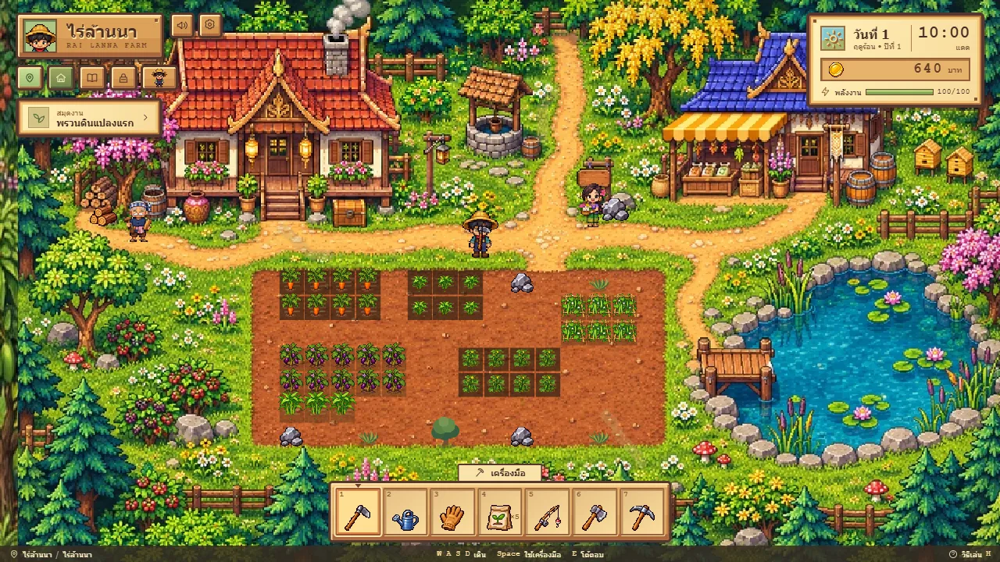
</p>

> สถานะ: กำลังพัฒนา ระบบหลักเล่นได้ครบวงจรแล้ว (ดูหัวข้อ "แผนงาน" สำหรับสิ่งที่ยังค้าง)
> ภาพทั้งหมดในหน้านี้ถ่ายจากเกมจริง บางภาพจัดสถานะไว้ก่อน (เช่น ปลูกผักไว้แล้ว มีสัตว์ในคอก) เพื่อให้เห็นระบบครบในภาพเดียว

## เริ่มเล่น

ต้องมี [Node.js](https://nodejs.org) และ npm (ทดสอบกับ Node 26)

```bash
npm install
npm run dev
```

แล้วเปิด http://localhost:5173 ในเบราว์เซอร์

คำสั่งอื่น ๆ

| คำสั่ง | ทำอะไร |
|---|---|
| `npm test` | รันชุดทดสอบกติกาเกม (Vitest) |
| `npm run typecheck` | ตรวจชนิดข้อมูลด้วย TypeScript |
| `npm run build` | ตรวจชนิดแล้วสร้างไฟล์สำหรับเผยแพร่ในโฟลเดอร์ `dist` |
| `npm run preview` | ลองเปิดไฟล์ที่ build แล้ว |

ถ้าอยากลองบนมือถือในเครือข่ายเดียวกัน ให้รัน `npm run dev -- --host` แล้วเปิดที่อยู่ IP ของเครื่องบนมือถือ

## วิธีเล่น

<p align="center">
  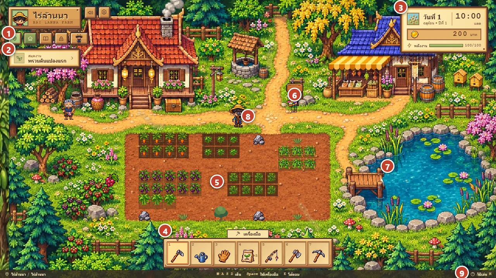
</p>

| เลข | คืออะไร | ใช้ยังไง |
|:-:|---|---|
| 1 | เมนูหลัก | แผนที่เดินทาง · ไร่ · บันทึกฟาร์ม · กระเป๋า · แต่งตัวและสัตว์เลี้ยง |
| 2 | สมุดงาน | บอกงานแนะนำถัดไป กดเพื่อเปิดบันทึกฟาร์ม |
| 3 | วัน ฤดู เวลา เงิน พลังงาน | ทุกงานกินพลังงาน ถ้าหมดจะป่วยและต้องไปโรงพยาบาล |
| 4 | แถบเครื่องมือ | กดเลข 1–7 หรือคลิกเพื่อเลือก |
| 5 | แปลงดิน | คลิกช่องดิน ตัวละครจะเดินไปใช้เครื่องมือให้ จอบพรวน บัวรดน้ำ ถุงเมล็ดปลูก มือเก็บเกี่ยว |
| 6 | ชาวบ้านและป้ายสถานที่ | คลิกหรือเดินเข้าใกล้แล้วกด E เพื่อคุย ซื้อของ รับงาน |
| 7 | บ่อน้ำ | เลือกเบ็ด (5) แล้วเดินไปริมน้ำกด Space กดอีกครั้งเมื่อปลากินเบ็ดและเข็มเข้าแถบสีเขียว |
| 8 | ตัวละครของคุณ | เดินด้วย WASD หรือลูกศร หรือคลิกพื้นทางเดิน |
| 9 | วิธีเล่น | กด H เปิดคู่มือในเกม |

### ปุ่มลัด

| ปุ่ม | ทำอะไร |
|---|---|
| WASD หรือลูกศร | เดิน |
| Space | ใช้เครื่องมือกับช่องตรงหน้า (หรือเหวี่ยง/ดึงเบ็ด) |
| 1 จอบ · 2 บัวรดน้ำ · 3 มือเก็บเกี่ยว · 4 ถุงเมล็ด · 5 เบ็ด · 6 ขวาน · 7 อีเต้อ | เลือกเครื่องมือ |
| Q | สลับชนิดเมล็ดในถุง |
| E | โต้ตอบกับสถานที่หรือคนที่อยู่ใกล้ |
| M · I · J · H | แผนที่เดินทาง · กระเป๋า · บันทึกฟาร์ม · วิธีเล่น |
| F2 | เริ่มเกมใหม่ (ต้องกด Y ยืนยัน) |
| Esc | ปิดหน้าต่าง หรือเก็บเบ็ด |

### วงจรหนึ่งวัน

1. ตื่นเช้า ดูพยากรณ์อากาศของวันนี้และพรุ่งนี้ อ่านรายงานตอนเช้า (ของที่ขายได้ พืชที่โต ข่าวงานประเพณี)
2. ทำงาน: พรวนดิน ปลูก รดน้ำ เก็บเกี่ยว ตกปลา ขุดแร่ ดูแลสวนและสัตว์
3. ใส่ของที่จะขายลงลังส่งของ เงินเข้าเช้าวันถัดไป
4. แวะหมู่บ้านหรือกาดเพื่อซื้อเมล็ด เครื่องมือ อาหาร ส่งงานให้ชาวบ้าน
5. เข้านอนก่อนพลังหมด เกมบันทึกให้อัตโนมัติทุกเช้า

หนึ่งวัน (06:00–24:00) ยาวราว 10 นาทีจริง ถ้าถึงเที่ยงคืนยังไม่นอนจะล้มหลับ เลเวลที่สูงขึ้นทำให้อยู่ดึกได้นานขึ้นและมีพลังงานสูงสุดมากขึ้น

### บนมือถือ

เกมรับการแตะ (คลิกพื้นเพื่อเดิน คลิกป้ายเพื่อใช้งาน) ปุ่มและเมนูอยู่บนหน้าจอ ไม่ต้องใช้คีย์บอร์ด
ฉากเลื่อนซ้ายขวาด้วยนิ้ว ภาพด้านล่างถ่ายจากโหมดจำลองหน้าจอมือถือของเบราว์เซอร์ (กว้าง 390 พิกเซล) ยังไม่ได้ทดสอบการแตะเล่นจริงหรือบนเครื่องจริง
และยังไม่มีแบบติดตั้งเป็นแอป (เปิดผ่านเบราว์เซอร์เท่านั้น)

<p align="center">
  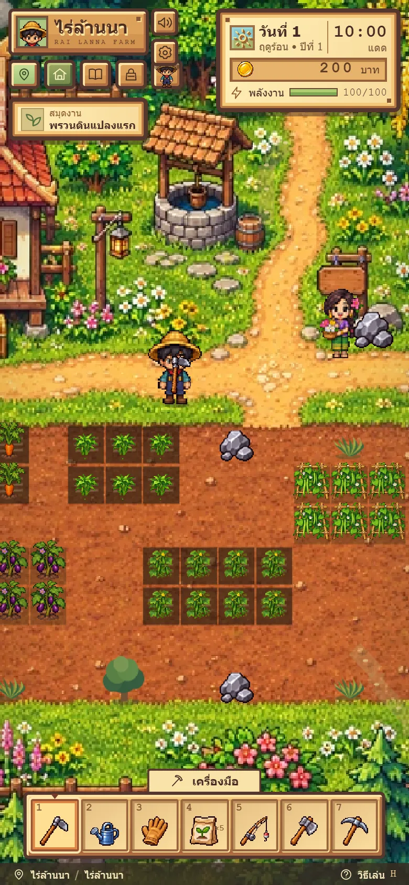
  &nbsp;&nbsp;
  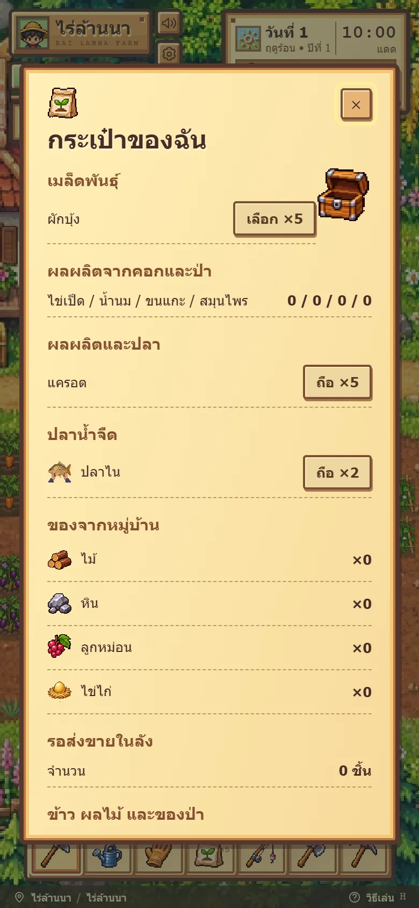
</p>

## ระบบในเกม

### ไร่ ผัก และสภาพอากาศ

- **ผัก 19 ชนิด:** ปลูกในแปลงหน้าบ้าน ต้องรดน้ำทุกวัน ซื้อเมล็ดได้ที่แผงในไร่และที่กาด ราคาและจำนวนวันโตต่างกันตามชนิด
- **4 ฤดู:** ร้อน → ใบไม้ร่วง → หนาว → ใบไม้ผลิ ฤดูละ 14 วัน (ปีละ 56 วัน) พืชที่ไม่ทนฤดูใหม่จะเหี่ยว เกมเตือนล่วงหน้า 3 วัน
- **อากาศ 5 แบบ:** แดด ฝน แดดจัด พายุฝน หิมะ มีพยากรณ์ของพรุ่งนี้เสมอ ฝนรดน้ำให้เอง พายุฝนอาจทำให้ต้นเหี่ยว แดดจัดทำให้ทุกงานเหนื่อยขึ้น
- **กลางวันกลางคืน:** ฟ้ามืดลงตามเวลา โคมไฟที่ปักไว้จะติดเมื่อมืด

<table>
  <tr>
    <td width="50%">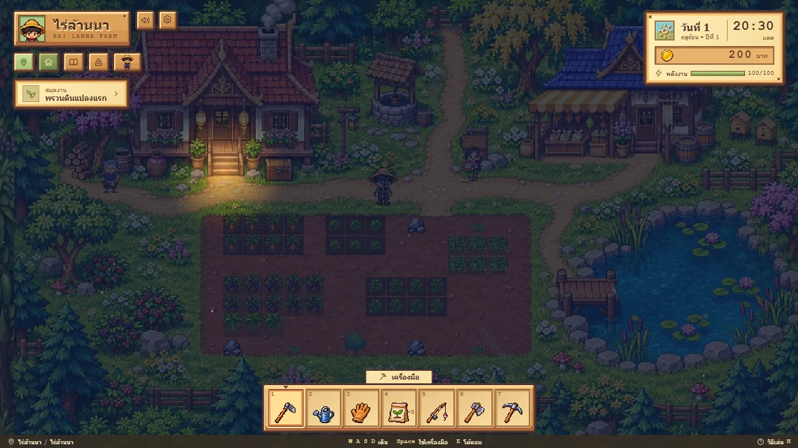</td>
    <td width="50%">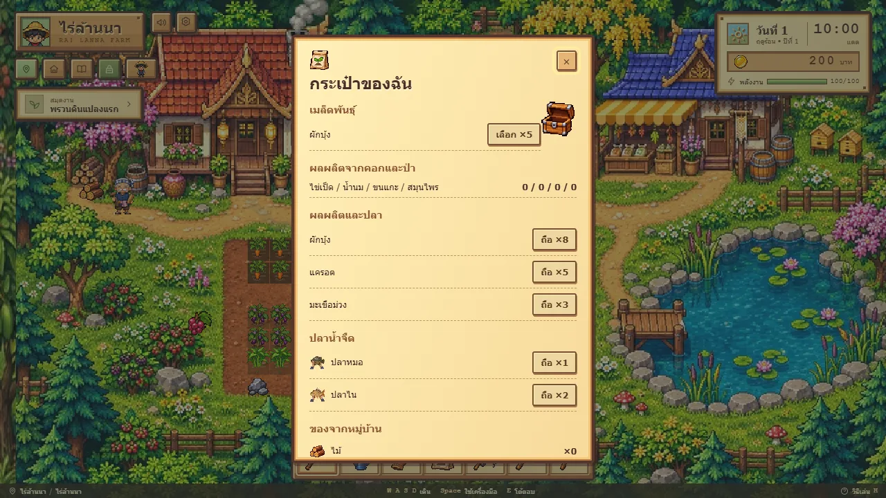</td>
  </tr>
  <tr>
    <td align="center">กลางคืนในไร่</td>
    <td align="center">กระเป๋า: ผัก ปลา ของป่า ของจากสัตว์</td>
  </tr>
</table>

### ตกปลา

ปลา 14 ชนิด (น้ำจืด 10 น้ำเค็ม 4) ที่ออกตามฤดู เวลา อากาศ และแหล่งน้ำ แหล่งตกปลามี 3 แห่ง คือบ่อในไร่ สระบัวแก้ว และหาดอ่าวมุก
ต้องกดเมื่อเข็มเข้าแถบสีเขียว ปลาแต่ละชนิดมีแถบกว้างแคบต่างกัน เบ็ดรุ่นดีทำให้แถบกว้างขึ้น และค่าโชคเพิ่มโอกาสได้ปลาแพง

<table>
  <tr>
    <td width="50%">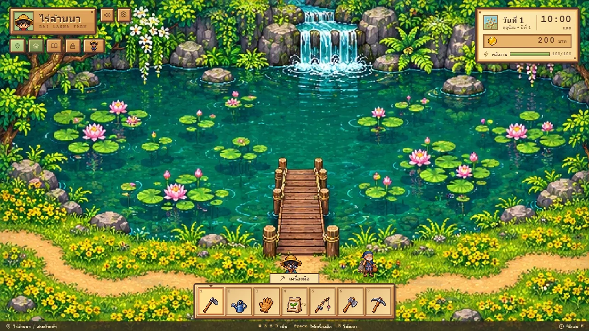</td>
    <td width="50%">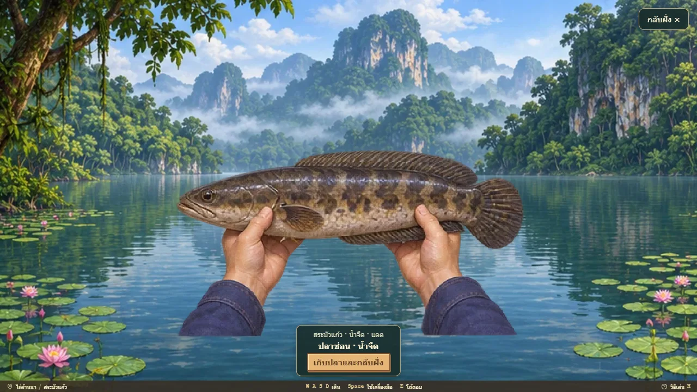</td>
  </tr>
  <tr>
    <td align="center">สระบัวแก้ว</td>
    <td align="center">จับได้แล้ว ชูปลาให้ดู</td>
  </tr>
</table>

### สวนไม้ผล และแยมผลไม้

- 6 หลุมปลูก ต้นไม้ 4 ชนิด: กล้วย มะม่วง ลำไย ส้ม ซื้อกล้ามาปลูก รดน้ำจนโต แล้วออกผลตามฤดูของมันเป็นรอบ ๆ
- ใส่ปุ๋ยให้ผลเพิ่ม พายุฝนพัดผลร่วงครึ่งหนึ่งจึงต้องเก็บหนีพายุ ต้นที่ไม่ไหวโค่นทิ้งได้
- ผลไม้ส่งขายได้ หรือเอาไปทำแยมที่เตาในห้องกินข้าว (ต้องต่อเติมบ้านก่อน) ผลไม้ 2 ส่วนได้แยม 1 กระปุก รอหนึ่งคืน ขายได้เท่าผลไม้ 3 ส่วน

<p align="center">
  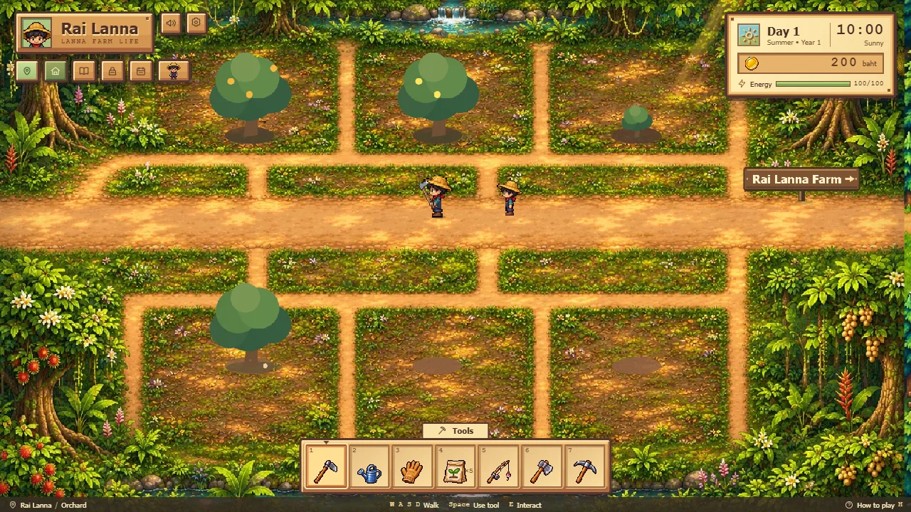
</p>

### ขุดแร่ เลเวล และเครื่องมือ

- **ถ้ำศิลาดาว:** สายแร่แต่ละจุดจะมีหรือไม่มีในแต่ละวัน ขุดแล้วหมดต้องรอพรุ่งนี้ แร่ 5 ชนิด (ทองแดง เหล็ก เงิน ทองคำ ผลึกดาว) ใช้อีเต้อขุด ได้แร่ชนิดถัดไปติดมือเป็นโบนัสตามค่าโชค
- **ทุ่งบุกเบิก:** เปิดที่ดินใหม่ด้วยการถางหญ้า ตัดไม้ ทุบหิน แล้วพรวนปลูกต่อได้ ทุ่งผืนที่สูงขึ้นต้องใช้เครื่องมือรุ่นสูงขึ้น
- **เลเวลและค่าสถานะ:** ทำงานแล้วได้ XP เลเวลขึ้นได้แต้มไปเพิ่ม แรงงาน ความอึด โชค เพิ่มพลังงานสูงสุดและเวลานอน
- **ช่างตีเหล็ก:** นำแร่ไปอัปเกรดจอบ ขวาน อีเต้อ ซื้อโคมไปปักไว้ตามทาง
- **ภารกิจชาวเวียง:** รับรางวัลเมื่อเปิดแปลงแรก ขุดแร่ และตกปลาครบ

<table>
  <tr>
    <td width="50%">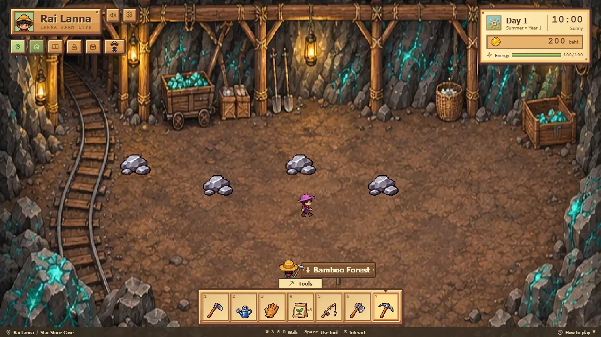</td>
    <td width="50%">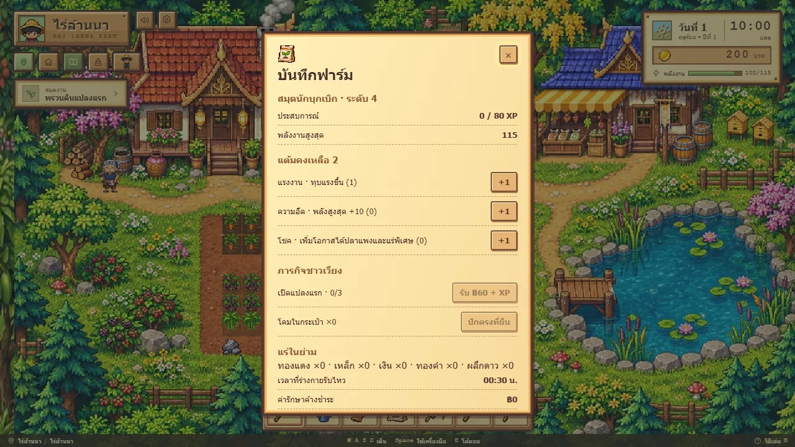</td>
  </tr>
  <tr>
    <td align="center">ถ้ำศิลาดาว</td>
    <td align="center">บันทึกฟาร์ม: เลเวลและค่าสถานะ</td>
  </tr>
</table>

### สัตว์เลี้ยงในคอก

ไก่ เป็ด วัว และแกะที่คอกปศุสัตว์ ซื้อสัตว์ ให้อาหารตัวละหนึ่งส่วนต่อวัน ผลผลิต (ไข่ นม ขนแกะ) เข้ากระเป๋าเช้าวันถัดไป
ขายแยกชิ้นให้พ่อค้าที่กาดได้ นอกจากนี้ยังสร้างเล้าไก่เองที่ไร่ได้

<p align="center">
  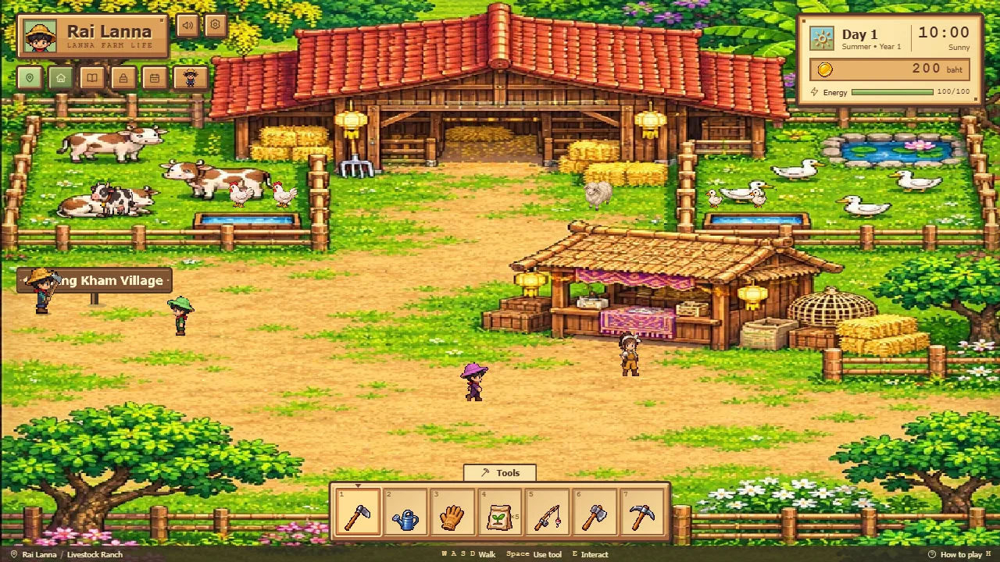
</p>

### หมู่บ้าน กาด และเพื่อนบ้าน

- **หมู่บ้านเวียงคำ:** มะลิและลุงชัยมีระดับมิตรภาพ รับของขวัญ และมีคำขอประจำวัน ลุงชัยยังขายที่เกษตรผืนใหม่ ต่อเติมบ้านตามเลเวล และสร้างเล้าไก่ให้
- **กระดานคำขอ:** รับงานส่งของ (ผักให้ครัวของมะลิ หรือผลไม้ให้ลุงชัย) ได้เงินและมิตรภาพ วันละหนึ่งงาน
- **กาดเวียงคำ:** แผงเมล็ดพันธุ์ ร้านอาหาร ช่างตีเหล็ก และพ่อค้ารับซื้อของ
- **โรงพยาบาลเวียงคำ:** พลังงานหมดแล้วต้องมาพักฟื้น เสียค่ารักษา ฿60
- **ป่าผักหวานและป่าไผ่:** เก็บของป่า ผักกูด หม่อนป่า กล้วยป่า ที่ป่าผักหวาน (เก็บแล้วงอกใหม่ภายในไม่กี่วัน) และสมุนไพร ไม้ไผ่ ที่ป่าไผ่

<table>
  <tr>
    <td width="50%">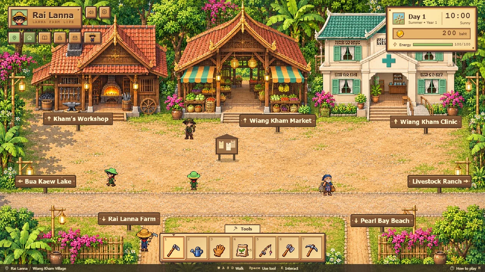</td>
    <td width="50%">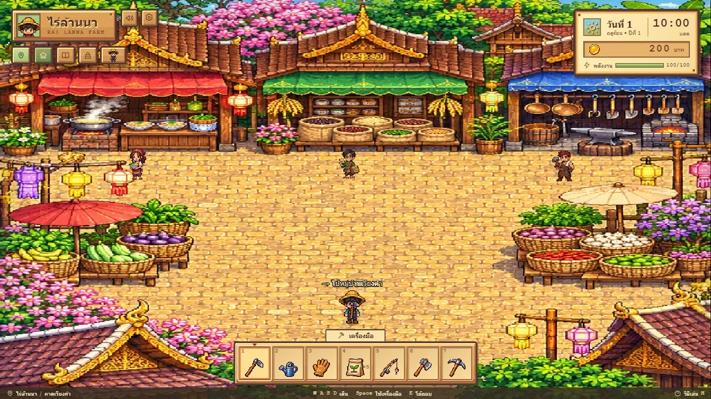</td>
  </tr>
  <tr>
    <td align="center">หมู่บ้านเวียงคำ</td>
    <td align="center">กาดเวียงคำ</td>
  </tr>
  <tr>
    <td width="50%">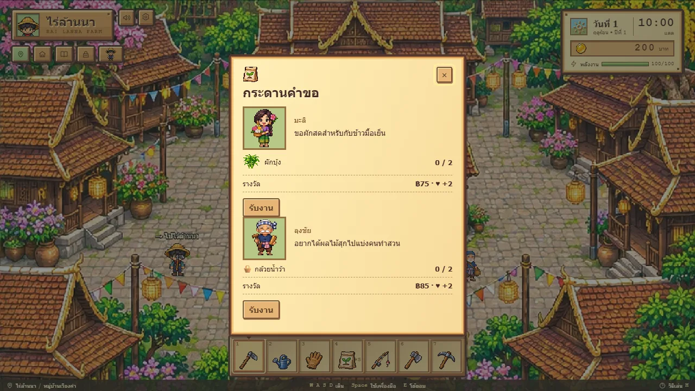</td>
    <td width="50%">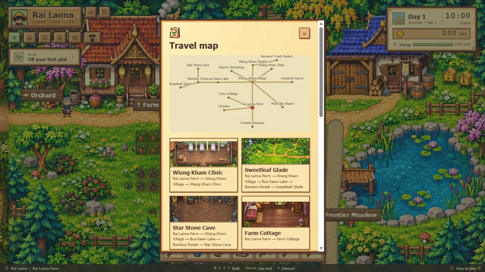</td>
  </tr>
  <tr>
    <td align="center">กระดานคำขอ</td>
    <td align="center">แผนที่เดินทาง</td>
  </tr>
</table>

### งานประเพณี 6 งานต่อปี

แต่ละงานกินเวลา 90 นาที ร่วมได้เฉพาะวันงานและในเวลางาน วันพายุฝนงานงด เพิ่มมิตรภาพกับเพื่อนบ้านทุกคน
สรุปตอนเช้าประกาศงานล่วงหน้า 2 วันพร้อมของที่ต้องเตรียม

| งาน | วัน | ได้อะไร |
|---|---|---|
| สงกรานต์ ปี๋ใหม่เมือง | ร้อน วันที่ 6 | พลังงานเพิ่ม |
| บุญบั้งไฟ | ร้อน วันที่ 12 | ใช้ไม้ 3 ท่อน พยากรณ์พรุ่งนี้กลายเป็นฝน |
| งานแลกเมล็ดพันธุ์ | ใบไม้ร่วง วันที่ 2 | เมล็ดแตงกวา 3 ซอง |
| แข่งเรือยาว | ใบไม้ร่วง วันที่ 11 | ใช้พลังงาน 30 ชนะ (โอกาส 50%) ได้ ฿200 แพ้ได้ ฿40 |
| ยี่เป็ง ลอยโคม | หนาว วันที่ 3 | ค่าโคม ฿30 เพื่อนบ้านประทับใจมาก |
| ตานข้าวใหม่และประกวดพืชผล | หนาว วันที่ 10 | ของชิ้นที่แพงที่สุดในกระเป๋าได้รางวัล 4 เท่าของราคา |

<p align="center">
  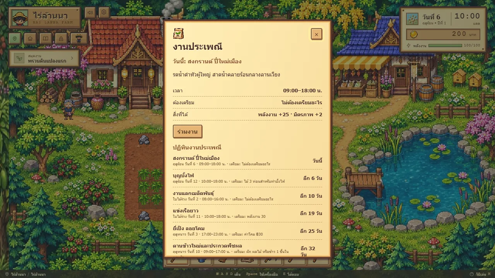
</p>

### แต่งตัวและสัตว์เลี้ยง

เปลี่ยนชุดได้ 3 สี รับสุนัขหรือแมวมาเลี้ยงหนึ่งตัว ลูบหัวได้วันละครั้ง และเลือกให้ตามเดินทางหรือรอที่บ้าน

<p align="center">
  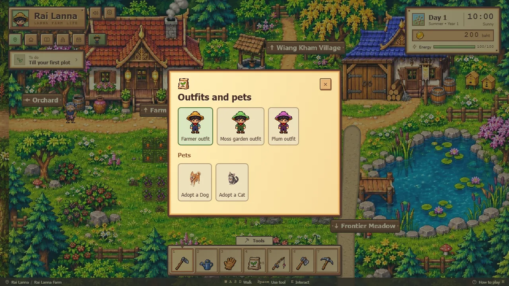
</p>

### เซฟอัตโนมัติ

บันทึกทุกเช้าวันใหม่ลงเบราว์เซอร์ (localStorage) เซฟรุ่นเก่าถูกแปลงเป็นรุ่นล่าสุดให้เอง ปิดเกมกลางวัน งานของวันนั้นจะหาย ต้องเข้านอนก่อน

## แผนงาน

แต่ละขั้นมีเอกสารออกแบบของตัวเองใน `docs/superpowers/specs/` (บางฉบับเขียนก่อนระบบจะเปลี่ยน เช่น นาข้าว)

1. ~~วงจรหนึ่งวัน~~
2. ~~ปฏิทิน ฤดู และดินฟ้าอากาศ~~ (ตอนนี้ 4 ฤดู มีหิมะ)
3. ~~ตกปลา~~
4. ~~นาข้าว~~ ถอดออกแล้ว ใช้การขยายที่เกษตรและทุ่งบุกเบิกแทน
5. ~~สวนผลไม้~~ (รวมแยมผลไม้)
6. ~~สัตว์เลี้ยง~~ (ไก่ เป็ด วัว แกะ)
7. ~~หมู่บ้าน เพื่อนบ้าน งานประเพณี~~
8. ~~ขุดแร่ เลเวล เครื่องมือ และของป่า~~
9. ภาพและเสียงแนวล้านนา: ส่วนใหญ่เสร็จแล้ว

สิ่งที่อยากทำต่อ

- ภาพฉากตามฤดู (ตอนนี้ฉากไร่ใช้ภาพเดียวทุกฤดู) และไอคอนผลไม้ในหน้าต่างสวน
- งานประเพณีของฤดูใบไม้ผลิ (ตอนนี้ฤดูนี้ไม่มีงานเลย)
- ทดสอบบนมือถือจริง และทำให้ติดตั้งลงหน้าจอหลักเป็นแอปได้ (PWA)

## โครงสร้างโปรเจกต์

```
src/
  rules/         กติกาเกมล้วน ๆ ไม่ import Phaser มีชุดทดสอบคู่กัน
    estate.ts      รวมสวนผลไม้ งานประเพณี และของขาย (orchard, festival, goods, preserves)
    frontier.ts    เลเวล เครื่องมือ ถางที่ ขุดแร่ ภารกิจ
    life.ts        ของป่า ป่วย โรงพยาบาล เวลานอน
    requests.ts    กระดานคำขอ
    property.ts    ซื้อที่เกษตร ต่อเติมบ้าน
    country.ts     สถานที่ กาด คอกสัตว์
    village.ts     เพื่อนบ้าน เล้าไก่ วัสดุ
  data/          ตารางตัวเลข: พืช ปลา ไม้ผล งานประเพณี ราคา (แก้ความสมดุลที่นี่)
  presentation/  หน้าจอ: แผนที่ ป้ายสถานที่ หน้าต่าง ไอคอน เสียง เพลง
  scenes/        ฉาก Phaser: วาดสถานะ รับคำสั่ง และส่งเข้ากติกา
  storage.ts     อ่านและเขียนเซฟใน localStorage
public/art/      ภาพทั้งหมดของเกม (รายการอยู่ใน docs/farm-art.json)
docs/readme/     ภาพหน้าจอที่ใช้ในหน้านี้
docs/superpowers/specs/   เอกสารออกแบบของแต่ละขั้น
docs/handoff/             งานที่ส่งต่อระหว่างผู้พัฒนา
.claude/skills/           skill ช่วยพัฒนาเกมสำหรับ Claude Code (ดูหัวข้อด้านล่าง)
```

หลักการสำคัญ: สถานะทั้งเกมเป็นข้อมูล JSON ก้อนเดียว และกติกาไม่รู้จัก Phaser
ฉากมีหน้าที่แค่แสดงผลและส่งคำสั่ง จึงทดสอบกติกาได้โดยไม่ต้องเปิดเบราว์เซอร์

ถ้าอยากปรับความสมดุล (ราคา จำนวนวันโต วันจัดงาน โอกาสเจอปลา ความยาววัน) ดูไฟล์ใน [`src/data/`](src/data/)

## เกี่ยวกับโฟลเดอร์ `.claude/skills`

เป็น skill เกม 17 ตัวที่คัดมาจาก
[gamedev-skills/awesome-gamedev-agent-skills](https://github.com/gamedev-skills/awesome-gamedev-agent-skills)
ให้ Claude Code ใช้ตอนพัฒนาเกมนี้ ไม่เกี่ยวกับตัวเกมตอนรัน ใช้สัญญาอนุญาต Apache-2.0
(ไฟล์ `LICENSE` และ `NOTICE` อยู่ในโฟลเดอร์นั้น) ลบทิ้งได้โดยไม่กระทบเกม

## สัญญาอนุญาต

ยังไม่ได้กำหนดสัญญาอนุญาตสำหรับตัวเกม
