# ไร่ล้านนา (Rai Lanna)

[English](README.md) · **ภาษาไทย**

เกมทำฟาร์ม 2 มิติบรรยากาศล้านนา เล่นบนเว็บเบราว์เซอร์ สร้างด้วย Phaser 4, TypeScript และ Vite
ปลูกผัก ทำสวนผลไม้ ตกปลา ขุดแร่ เลี้ยงสัตว์ ขายของที่ตลาด และร่วมงานประเพณีของหมู่บ้าน
เป็นเกมของเราเองในแนวทำฟาร์มคลาสสิก ใช้ภาพและบรรยากาศแบบล้านนา

ตัวเกมเป็นภาษาอังกฤษเป็นหลัก และสลับเป็นภาษาไทยได้ทุกเมื่อ (ภาพในหน้านี้ถ่ายจากเกมภาษาอังกฤษ)

<p align="center">
  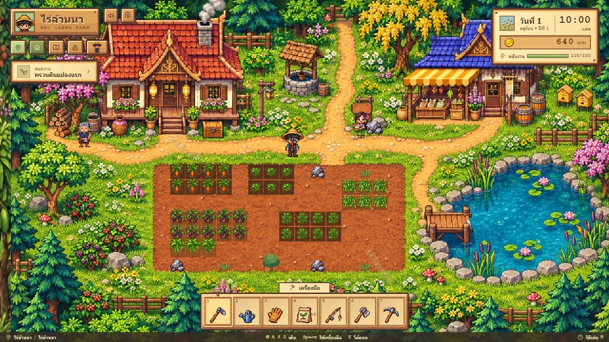
</p>

> สถานะ: อยู่ระหว่างพัฒนา ระบบหลักเล่นได้ครบตั้งแต่ต้นจนจบ (ดูหัวข้อ "แผนงาน" สำหรับสิ่งที่ยังเหลือ)
> ภาพทุกภาพในหน้านี้ถ่ายจากเกมจริง บางภาพจัดฉากก่อนถ่าย (ปลูกพืชไว้แล้ว ซื้อสัตว์ไว้แล้ว) เพื่อให้ภาพเดียวเห็นทั้งระบบ

## เริ่มเล่น

ต้องมี [Node.js](https://nodejs.org) และ npm (ทดสอบกับ Node 26)

```bash
npm install
npm run dev
```

แล้วเปิด http://localhost:5173 ในเบราว์เซอร์

คำสั่งอื่น

| คำสั่ง | ทำอะไร |
|---|---|
| `npm test` | รันชุดทดสอบกติกาเกม (Vitest) |
| `npm run typecheck` | ตรวจชนิดข้อมูลด้วย TypeScript |
| `npm run build` | ตรวจชนิดข้อมูล แล้วสร้างไฟล์สำหรับเผยแพร่ลงใน `dist` |
| `npm run preview` | เปิดดูไฟล์ที่ build แล้ว |

ถ้าจะลองบนมือถือในเครือข่ายเดียวกัน ให้รัน `npm run dev -- --host` แล้วเปิด IP ของคอมพิวเตอร์บนมือถือ

### เปลี่ยนภาษา

เปิด **Settings** (รูปเฟืองด้านบน) แล้วกดปุ่ม **Language · ภาษา** เกมจะบันทึกฟาร์มแล้วโหลดใหม่เป็นอีกภาษาหนึ่ง
เบราว์เซอร์จะจำภาษาที่เลือกไว้

## วิธีเล่น

<p align="center">
  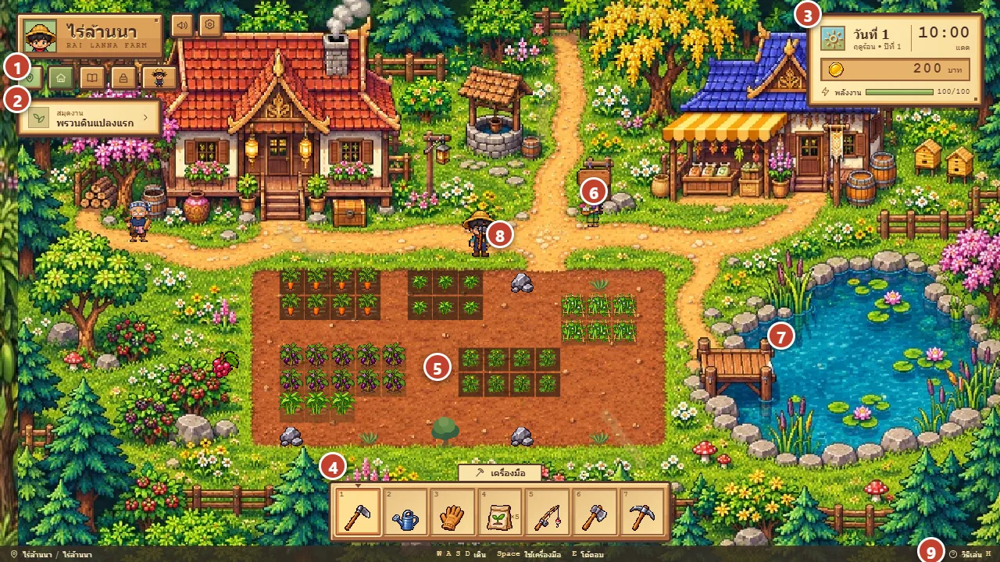
</p>

| เลข | คืออะไร | ใช้อย่างไร |
|:-:|---|---|
| 1 | เมนูหลัก | แผนที่เดินทาง · ฟาร์ม · สมุดฟาร์ม · กระเป๋า · ปฏิทิน · ชุดและสัตว์เลี้ยง |
| 2 | การ์ดงานที่ควรทำ | แนะนำงานถัดไป กดเพื่อเปิดสมุดฟาร์ม |
| 3 | วัน ฤดู เวลา เงิน พลังงาน | ทุกงานใช้พลังงาน ถ้าหมดจะป่วยและไปตื่นที่โรงพยาบาล |
| 4 | แถบเครื่องมือ | กด 1–7 หรือคลิกเพื่อเลือกเครื่องมือ |
| 5 | แปลงผัก | คลิกช่องดิน ตัวละครจะเดินไปใช้เครื่องมือ: จอบพรวนดิน ถุงเมล็ดปลูก บัวรดน้ำ มือเก็บเกี่ยว |
| 6 | ชาวบ้านและป้ายบอกทาง | คลิก หรือเดินเข้าไปแล้วกด E เพื่อคุย ซื้อของ หรือรับงาน |
| 7 | สระน้ำ | เลือกเบ็ด (5) เดินไปริมน้ำแล้วกด Space กดอีกครั้งตอนปลากินเบ็ดและเข็มอยู่ในแถบสีเขียว |
| 8 | ตัวละครของคุณ | เดินด้วย WASD หรือปุ่มลูกศร หรือคลิกที่ทางเดิน |
| 9 | วิธีเล่น | กด H เพื่อดูคู่มือในเกม |

### ปุ่ม

| ปุ่ม | ทำอะไร |
|---|---|
| WASD หรือลูกศร | เดิน |
| Space | ใช้เครื่องมือกับช่องตรงหน้า (หรือเหวี่ยงเบ็ดและดึงปลา) |
| 1 จอบ · 2 บัวรดน้ำ · 3 มือเก็บเกี่ยว · 4 ถุงเมล็ด · 5 เบ็ด · 6 ขวาน · 7 อีเต้อ | เลือกเครื่องมือ |
| Q | สลับเมล็ดในถุง |
| E | ใช้งานสถานที่หรือคุยกับคนที่อยู่ใกล้ |
| M · I · J · C · H | แผนที่เดินทาง · กระเป๋า · สมุดฟาร์ม · ปฏิทิน · วิธีเล่น |
| F2 | เริ่มเกมใหม่ (กด Y เพื่อยืนยัน) |
| Esc | ปิดหน้าต่าง หรือเก็บเบ็ด |

### หนึ่งวันในเกม

1. ตื่นนอน ดูอากาศวันนี้และพรุ่งนี้ อ่านรายงานยามเช้า (ขายอะไรได้ พืชโตแค่ไหน ข่าวงานประเพณี)
2. ทำงาน: พรวนดิน ปลูก รดน้ำ เก็บเกี่ยว ตกปลา ขุดแร่ ดูแลสวนผลไม้และสัตว์
3. ใส่ของที่จะขายลงลังส่งของ (ได้เงินเช้าวันถัดไป) หรือขายเองที่แผงของคุณในตลาดสด
4. แวะหมู่บ้านและตลาดเพื่อซื้อเมล็ด เครื่องมือ อาหาร และรับคำขอของชาวบ้าน
5. เข้าบ้านแล้วนอนบนเตียงก่อนพลังงานหมด เกมบันทึกทุกเช้า

หนึ่งวัน (06:00–24:00) ใช้เวลาจริงประมาณ 10 นาที ถ้ายังไม่นอนเมื่อถึงเวลาเข้านอนจะหมดแรงล้มและต้องจ่ายค่ารักษา
เลเวลสูงขึ้นจะอยู่ดึกได้นานขึ้นและมีพลังงานมากขึ้น

### การเดินทาง

แต่ละสถานที่เป็นแผนที่ภาพวาดของตัวเอง เดินออกขอบจอตามถนนหรือผ่านประตู ก็จะไปโผล่บนถนนเส้นเดียวกันของแผนที่ถัดไป
แผนที่เดินทาง (M) จะพาเดินไปเองโดยผ่านทุกสถานที่ระหว่างทาง

<table>
  <tr>
    <td width="50%">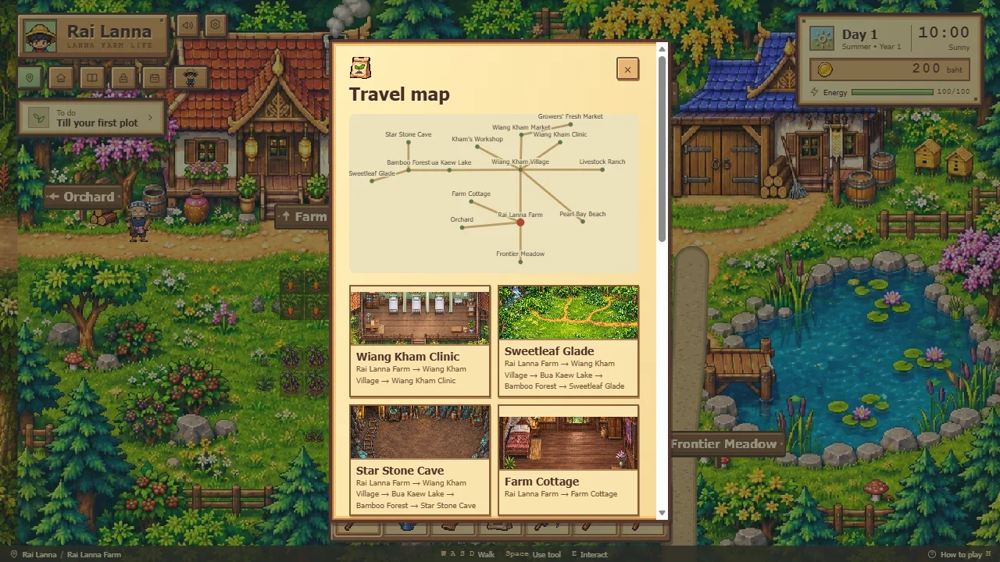</td>
    <td width="50%">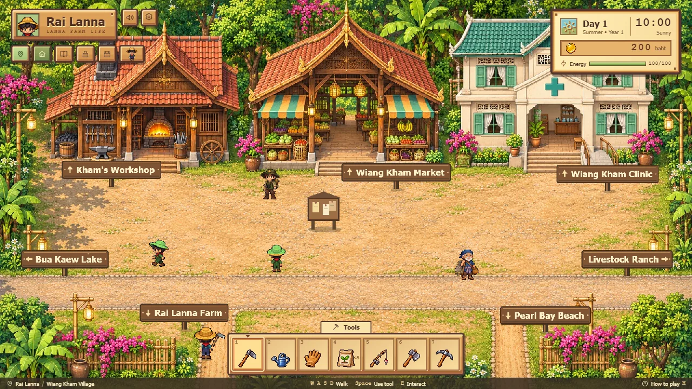</td>
  </tr>
  <tr>
    <td align="center">แผนที่เดินทาง</td>
    <td align="center">หมู่บ้านเวียงคำ: ป้ายชี้ไปยังถนนและประตูแต่ละทาง</td>
  </tr>
</table>

### บนมือถือ

เกมรับการแตะ (แตะพื้นเพื่อเดิน แตะป้ายเพื่อใช้งาน) และมีปุ่มครบบนจอ จึงไม่ต้องใช้คีย์บอร์ด
เลื่อนฉากไปด้านข้างด้วยนิ้วได้ ภาพด้านล่างมาจากโหมดจอมือถือของเบราว์เซอร์ (กว้าง 390 พิกเซล)
ยังไม่ได้ทดสอบเล่นด้วยการแตะบนมือถือจริง และยังติดตั้งเป็นแอปไม่ได้ (เล่นผ่านเบราว์เซอร์เท่านั้น)

<p align="center">
  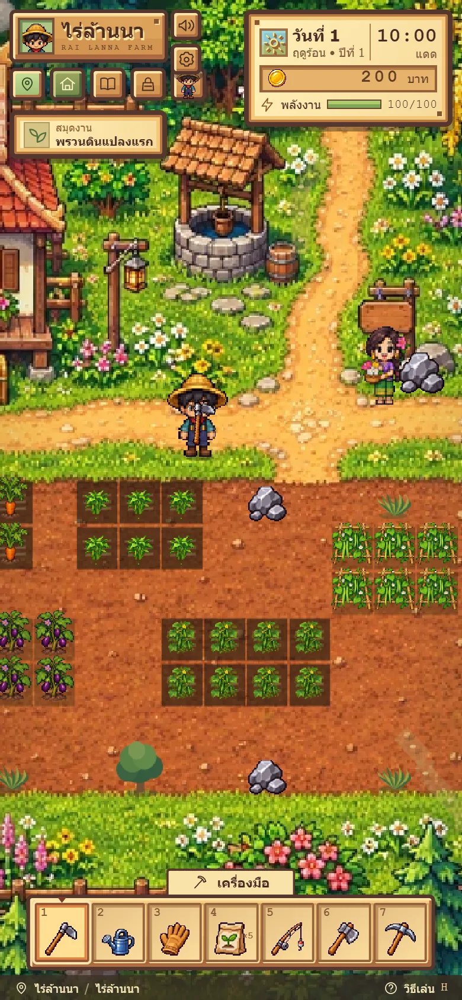
  &nbsp;&nbsp;
  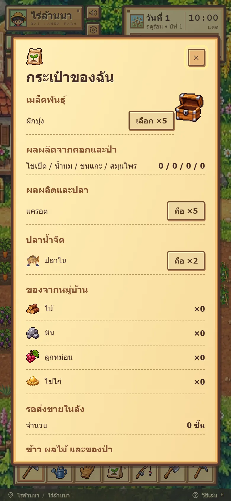
</p>

## มีอะไรในเกม

### ฟาร์ม พืช และอากาศ

- **พืช 29 ชนิด** ปลูกในแปลงข้างบ้านและรดน้ำทุกวัน เมล็ดขายที่ร้านเมล็ดพันธุ์ในกาดเวียงคำ ราคาและเวลาโตต่างกันไปตามชนิด
- **4 ฤดู** ร้อน → ใบไม้ร่วง → หนาว → ใบไม้ผลิ ฤดูละ 14 วัน (ปีละ 56 วัน) พืชที่ทนฤดูใหม่ไม่ได้จะเหี่ยว และเกมเตือนล่วงหน้า 3 วัน
- **อากาศ 5 แบบ** แดด ฝน แดดจัด พายุฝน และหิมะ มีพยากรณ์ของวันพรุ่งนี้เสมอ ฝนรดน้ำแปลงให้ พายุทำให้พืชเฉาได้ แดดจัดทำให้ทุกงานเหนื่อยขึ้น
- **กลางวันกลางคืน** ท้องฟ้ามืดลงตามเวลา และโคมไฟที่วางไว้จะสว่างหลังพลบค่ำ

<table>
  <tr>
    <td width="50%">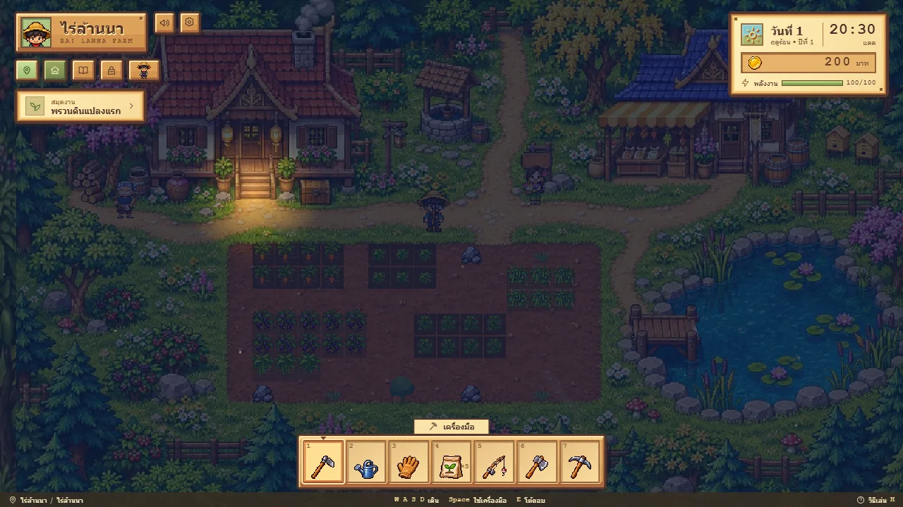</td>
    <td width="50%">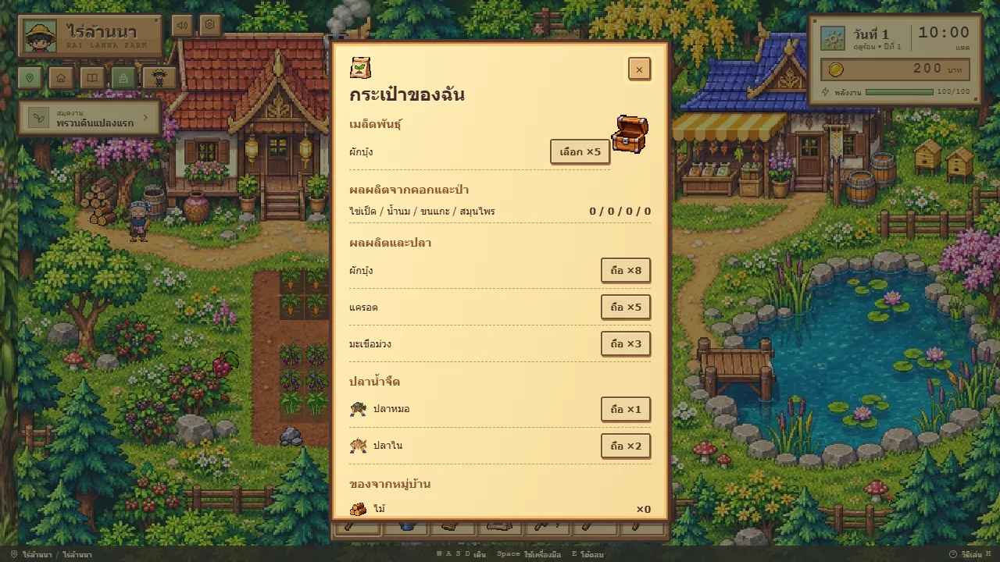</td>
  </tr>
  <tr>
    <td align="center">กลางคืนที่ฟาร์ม</td>
    <td align="center">กระเป๋า: เมล็ด ผลผลิต ปลา ของป่า</td>
  </tr>
</table>

### ตกปลา

ปลา 34 ชนิด (น้ำจืด 20 น้ำเค็ม 14) ที่ออกตามฤดู ช่วงเวลา อากาศ และแหล่งน้ำ ตกได้ 3 ที่: สระในฟาร์ม
สระบัวแก้ว และหาดอ่าวมุก การตกปลาเป็นมุมมองบุคคลที่หนึ่ง: รอปลากินเบ็ด แล้วกดตอนเข็มอยู่ในแถบสีเขียว
ปลาแต่ละชนิดมีแถบกว้างแคบต่างกัน เบ็ดที่ดีขึ้นทำให้แถบกว้างขึ้น เหยื่อ 4 แบบเพิ่มโอกาสเจอปลาหายาก และค่าโชคก็ช่วยด้วย

<table>
  <tr>
    <td width="50%">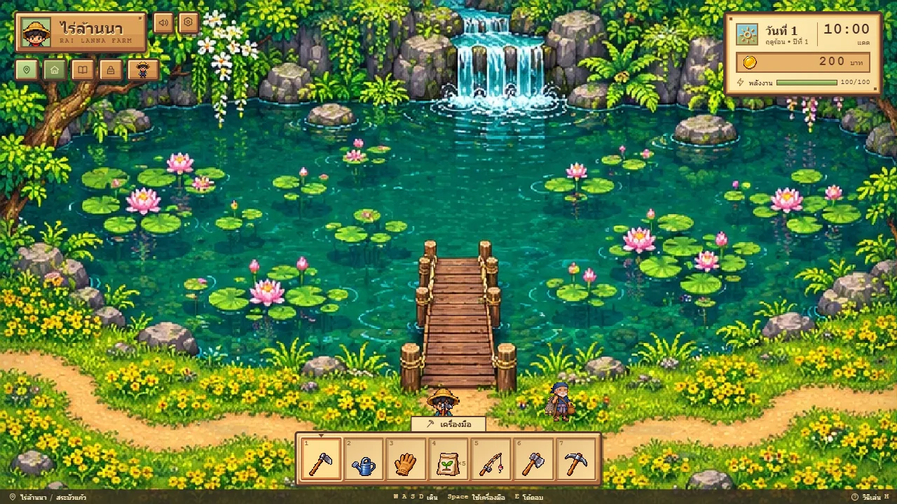</td>
    <td width="50%">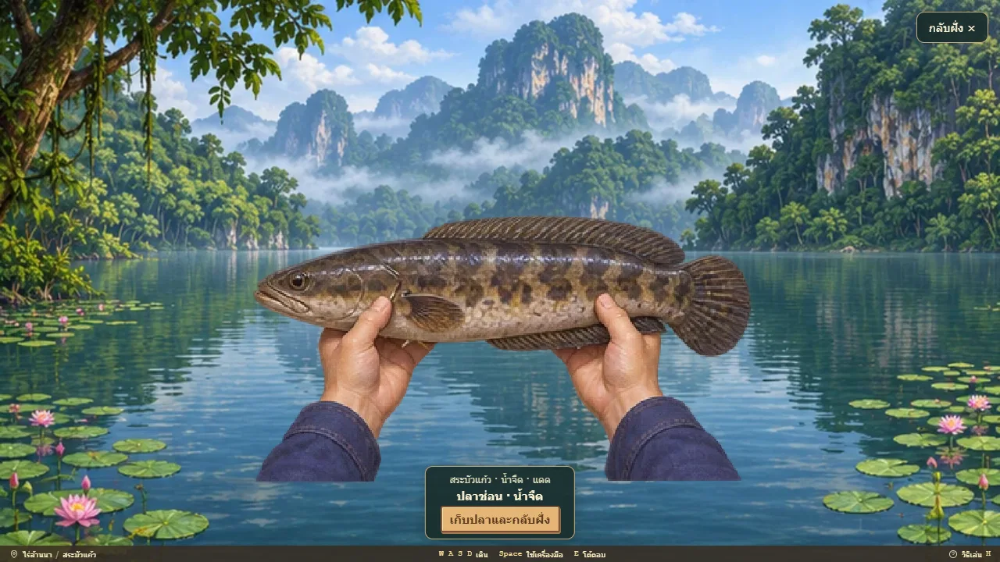</td>
  </tr>
  <tr>
    <td align="center">สระบัวแก้ว</td>
    <td align="center">ตกได้แล้ว</td>
  </tr>
</table>

### สวนผลไม้และแยมผลไม้

- 6 แปลงทางตะวันตกของฟาร์ม ต้นไม้ 4 ชนิด: กล้วย มะม่วง ลำไย และส้ม เคลียร์ไม้และหินออกจากแปลง ปลูกต้นกล้า รดน้ำจนโต แล้วจะออกผลเป็นรอบตามฤดูของมัน
- ปุ๋ยคอกทำให้ได้ผลเพิ่ม พายุทำให้ผลที่ติดอยู่ร่วงครึ่งหนึ่ง จึงควรเก็บก่อนพายุมา ต้นที่ไม่ต้องการแล้วโค่นทิ้งได้
- ผลไม้ขายได้ หรือทำแยมที่เตาในห้องอาหาร (ต้องต่อเติมบ้านก่อน): ผลไม้ 2 ผลได้แยม 1 ขวดในข้ามคืน มีค่าเท่าผลไม้ 3 ผล

<p align="center">
  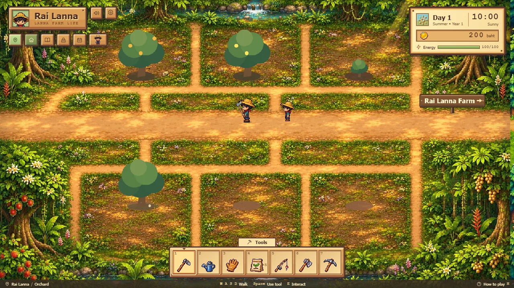
</p>

### ขุดแร่ เลเวล และเครื่องมือ

- **ถ้ำศิลาดาว** สายแร่แต่ละจุดอาจมีหรือไม่มีในแต่ละวัน และขุดแล้วหมดไป มีแร่ 5 ชนิด (ทองแดง เหล็ก เงิน ทอง ผลึกดาว) ขุดด้วยอีเต้อ และมีโอกาสได้แร่ชนิดถัดไปเพิ่มตามค่าโชค
- **ทุ่งบุกเบิก** เปิดที่ดินทำกินใหม่โดยถางหญ้า ต้นไม้ และหิน แล้วพรวนดินปลูกพืช แปลงถัดไปต้องใช้เครื่องมือที่ดีขึ้น
- **เลเวลและค่าพลัง** ทำงานได้ XP แต่ละเลเวลได้แต้มสำหรับ กำลัง ความอึด และโชค พลังงานเพิ่ม และเข้านอนได้ดึกขึ้น
- **ช่างตีเหล็ก** เอาแร่ไปแลกอัปเกรดจอบ ขวาน และอีเต้อ และซื้อโคมไฟไปวางตามทางเดิน
- **ภารกิจหมู่บ้าน** มีรางวัลสำหรับการถางที่ ขุดแร่ และตกปลา

<table>
  <tr>
    <td width="50%">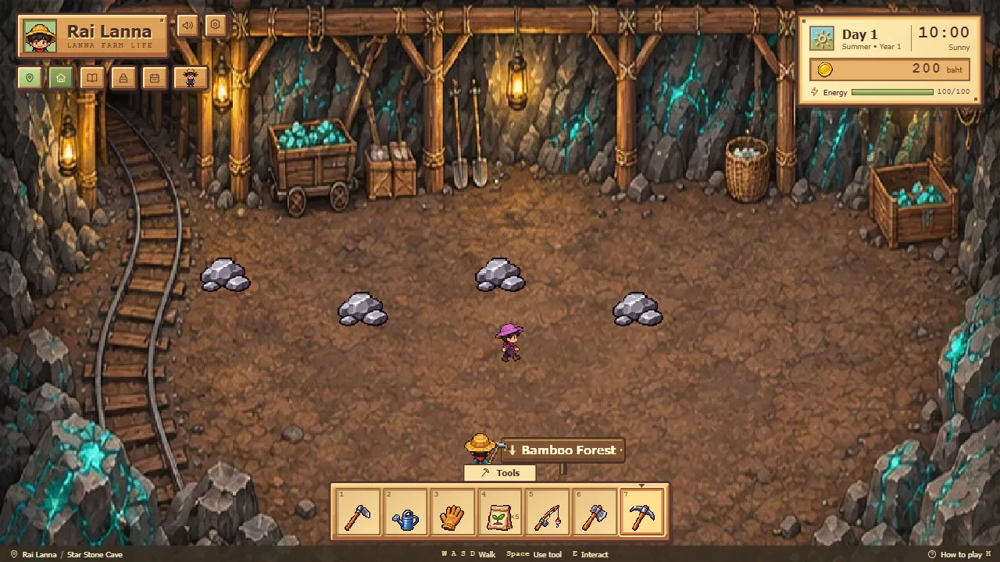</td>
    <td width="50%">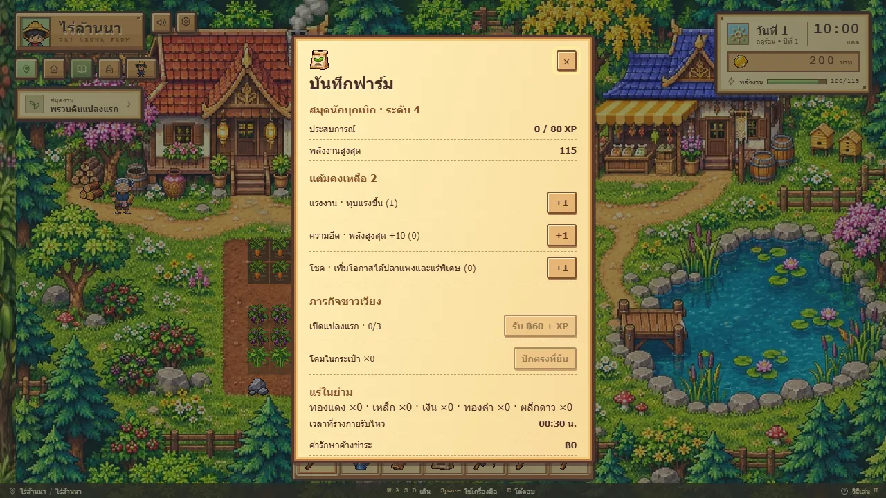</td>
  </tr>
  <tr>
    <td align="center">ถ้ำศิลาดาว</td>
    <td align="center">สมุดฟาร์ม: เลเวลและค่าพลัง</td>
  </tr>
  <tr>
    <td width="50%">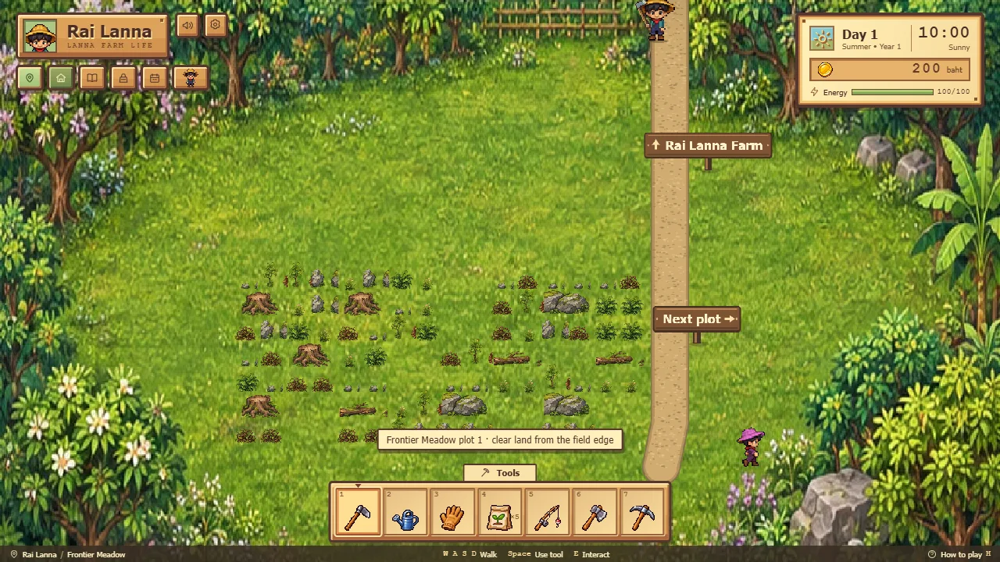</td>
    <td width="50%">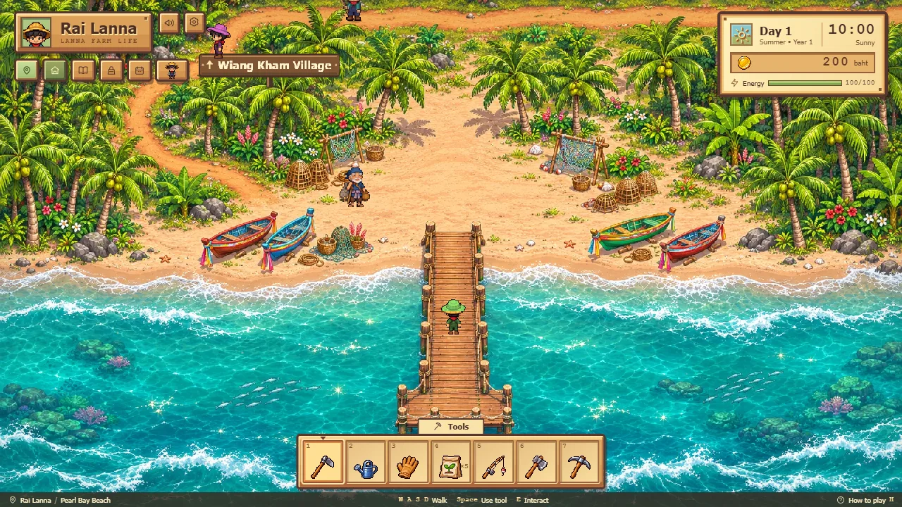</td>
  </tr>
  <tr>
    <td align="center">ทุ่งบุกเบิก รอการถาง</td>
    <td align="center">หาดอ่าวมุก</td>
  </tr>
</table>

### สัตว์ในคอกปศุสัตว์

ไก่ เป็ด วัว และแกะอยู่ที่คอกปศุสัตว์ ซื้อสัตว์ ให้อาหารตัวละหนึ่งส่วนต่อวัน แล้วผลผลิต (ไข่ นม ขนแกะ) จะอยู่ในกระเป๋าเช้าวันถัดไป
และสร้างเล้าไก่ไว้ในฟาร์มของตัวเองได้ด้วย

<p align="center">
  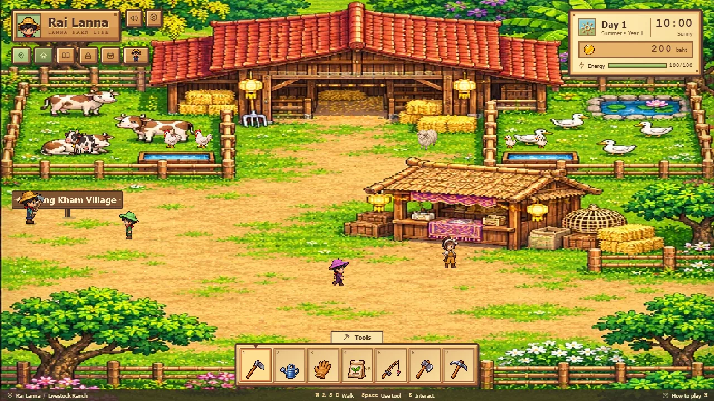
</p>

### หมู่บ้าน ตลาด และเพื่อนบ้าน

- **หมู่บ้านเวียงคำ** มะลิและลุงชัยมีระดับความสนิท รับของขวัญ และมีคำขอประจำวัน ลุงชัยยังขายแปลงเพิ่ม ต่อเติมบ้านตามเลเวล และสร้างเล้าไก่ให้
- **ชาวบ้านเดินไปมา** ชาวบ้านมีชื่อ 22 คนเดินตามเส้นทางประจำวันของตัวเอง บางคนเดินข้ามแผนที่ตามถนน เดินเข้าไปแล้วกด E เพื่อทักทาย วันงานประเพณีทุกคนจะมารวมกันที่ลานหมู่บ้าน
- **กระดานประกาศ** รับงานส่งของได้วันละ 1 งาน (ผักให้ครัวของมะลิ หรือผลไม้ให้ลุงชัย) ได้เงินและความสนิท
- **กาดเวียงคำ** ร้านเมล็ดพันธุ์ ร้านอาหาร ช่างตีเหล็ก และพ่อค้าที่รับซื้อของ
- **ตลาดสดชาวสวน** เปิดแผงของตัวเอง (07:00–18:00): เลือกของ จำนวน และราคา ลูกค้าซื้อตามงบของเขา ได้เงินทันที และวันงานประเพณีลูกค้าจะมากขึ้น
- **โรงพยาบาลเวียงคำ** ที่พักฟื้นเมื่อพลังงานหมด ค่ารักษา ฿60
- **ป่าผักหวานและป่าไผ่ร่มเย็น** เก็บผักกูด ลูกหม่อนป่า และกล้วยป่าที่ป่าผักหวาน (ขึ้นใหม่ในไม่กี่วัน) และเก็บสมุนไพรกับไม้ไผ่ในป่าไผ่

<table>
  <tr>
    <td width="50%">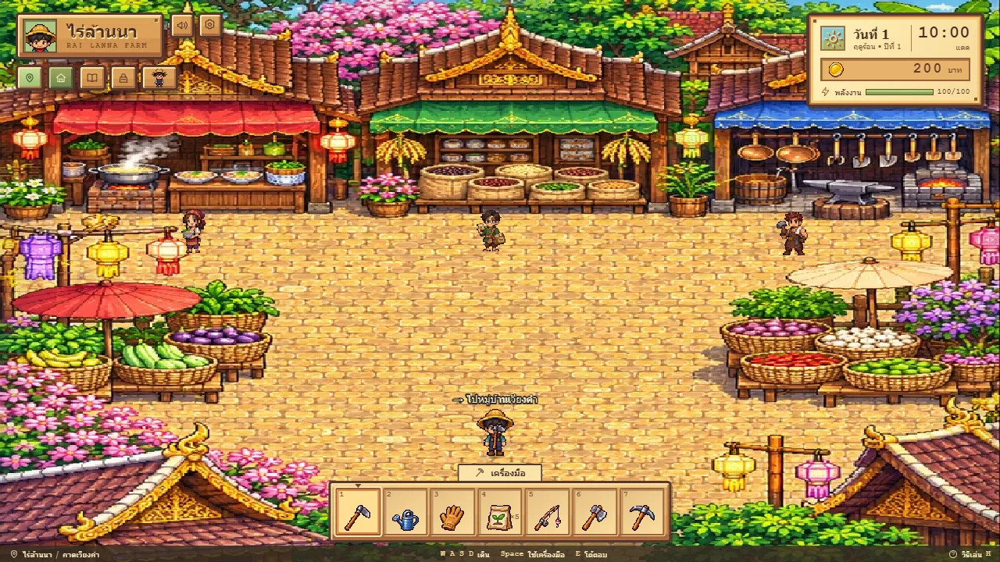</td>
    <td width="50%">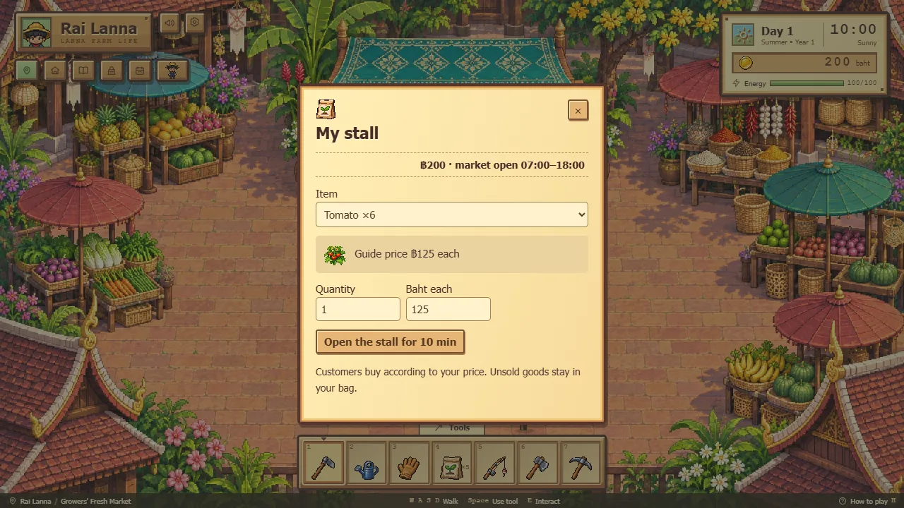</td>
  </tr>
  <tr>
    <td align="center">กาดเวียงคำ</td>
    <td align="center">แผงของคุณในตลาดสด</td>
  </tr>
</table>

<p align="center">
  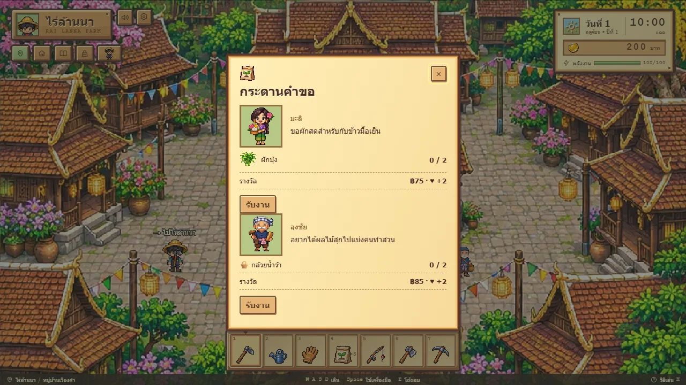
</p>

### งานประเพณี 7 งานต่อปี

แต่ละงานร่วมได้เฉพาะวันและช่วงเวลาของงาน และพายุจะทำให้งานยกเลิก ทุกงานเพิ่มความสนิทกับเพื่อนบ้านทุกคน
รายงานยามเช้าจะประกาศงานล่วงหน้า 2 วันพร้อมบอกของที่ต้องเตรียม และปฏิทิน (C) แสดงทั้งปี

| งาน | วัน | เวลา | สิ่งที่ได้ |
|---|---|---|---|
| สงกรานต์ ปี๋ใหม่เมือง | ฤดูร้อน วันที่ 6 | 09:00–18:00 | พลังงาน +25 |
| บุญบั้งไฟ | ฤดูร้อน วันที่ 12 | 10:00–18:00 | ใช้ไม้ 3 ท่อน พยากรณ์พรุ่งนี้กลายเป็นฝน |
| งานแลกเมล็ดพันธุ์ | ใบไม้ร่วง วันที่ 2 | 08:00–16:00 | เมล็ดแตงกวา 3 ซอง |
| แข่งเรือยาว | ใบไม้ร่วง วันที่ 11 | 10:00–18:00 | ใช้พลังงาน 30 ชนะ (โอกาส 50%) ได้ ฿200 แพ้ได้ ฿40 |
| ยี่เป็ง ลอยโคม | ฤดูหนาว วันที่ 3 | 17:00–23:00 | ค่าโคม ฿30 เพื่อนบ้านประทับใจเป็นพิเศษ |
| ตานข้าวใหม่และประกวดพืชผล | ฤดูหนาว วันที่ 10 | 09:00–17:00 | ของที่แพงที่สุดในกระเป๋าได้รางวัล 4 เท่าของราคา |
| กาดดอกไม้บาน | ใบไม้ผลิ วันที่ 5 | 08:00–18:00 | เมล็ดผักกาดหอม 4 ซอง |

<table>
  <tr>
    <td width="50%">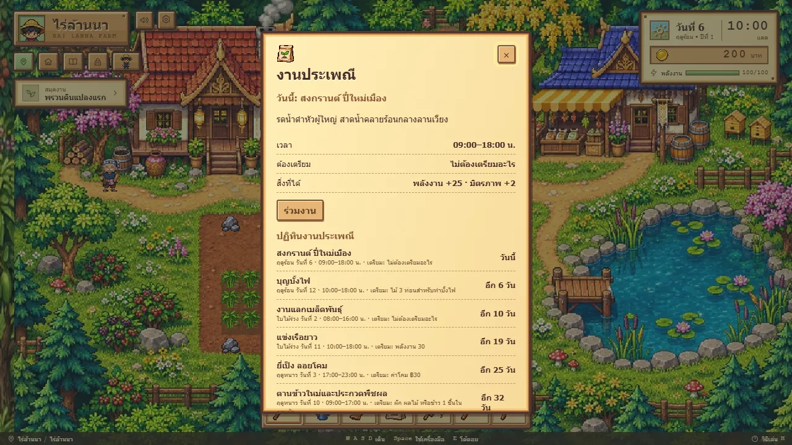</td>
    <td width="50%">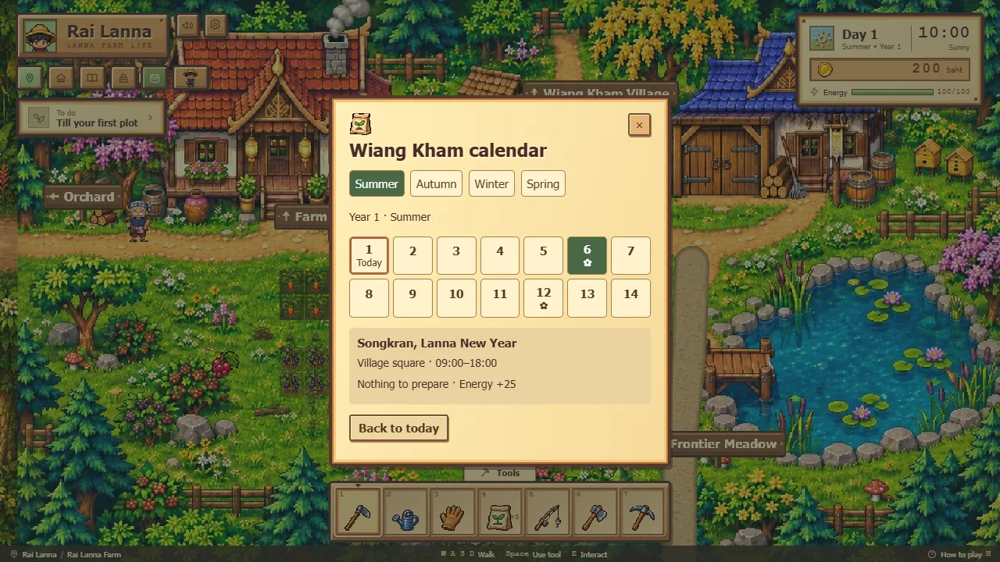</td>
  </tr>
  <tr>
    <td align="center">วันงานประเพณี</td>
    <td align="center">ปฏิทิน</td>
  </tr>
</table>

### ชุดและสัตว์เลี้ยง

มีชุดให้ใส่ 3 ชุด และรับเลี้ยงหมาหรือแมวได้ 1 ตัว ลูบหัวได้วันละครั้ง และเลือกได้ว่าจะให้เดินตามหรือรออยู่บ้าน

<p align="center">
  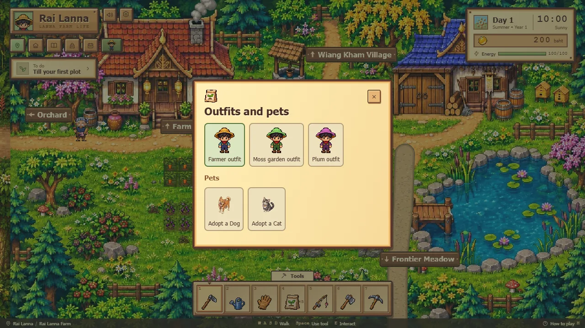
</p>

### บันทึกอัตโนมัติ

เกมบันทึกลงเบราว์เซอร์ (localStorage) ทุกเช้าวันใหม่ และเซฟรุ่นเก่าจะถูกอัปเกรดเป็นรูปแบบปัจจุบันให้เอง
ถ้าปิดเกมกลางวัน งานของวันนั้นจะหาย จึงควรเข้านอนก่อน

## แผนงาน

1. ~~วงจรประจำวัน~~
2. ~~ปฏิทิน ฤดู และอากาศ~~ (4 ฤดู มีหิมะ)
3. ~~ตกปลา~~ (มุมมองบุคคลที่หนึ่ง มีเหยื่อ)
4. ~~นาข้าว~~ ถอดออกแล้ว ใช้การขยายที่ดินและทุ่งบุกเบิกแทน
5. ~~สวนผลไม้~~ (พร้อมแยมผลไม้)
6. ~~สัตว์~~ (ไก่ เป็ด วัว แกะ)
7. ~~หมู่บ้าน เพื่อนบ้าน งานประเพณี~~ (พร้อมแผงตลาดสดและปฏิทิน)
8. ~~ขุดแร่ เลเวล เครื่องมือ และของป่า~~
9. ~~ภาษาอังกฤษและภาษาไทย~~
10. ภาพและเสียงแบบล้านนา: เสร็จเกือบหมดแล้ว

ยังต้องทำ

- ฉากตามฤดู (ฟาร์มใช้ภาพเดียวทุกฤดู)
- ทดสอบเล่นบนมือถือจริง และติดตั้งลงหน้าจอหลักเป็นแอป (PWA)

## เกี่ยวกับโฟลเดอร์ `.claude/skills`

เป็นสกิลพัฒนาเกม 17 ตัวที่เลือกมาจาก
[gamedev-skills/awesome-gamedev-agent-skills](https://github.com/gamedev-skills/awesome-gamedev-agent-skills)
สำหรับให้ Claude Code ใช้ระหว่างพัฒนาเกมนี้ ไม่มีส่วนเกี่ยวข้องตอนเกมทำงาน อยู่ภายใต้สัญญาอนุญาต Apache-2.0
(`LICENSE` และ `NOTICE` อยู่ในโฟลเดอร์นั้น) และลบทิ้งได้โดยไม่กระทบเกม

## สัญญาอนุญาต

ยังไม่ได้เลือกสัญญาอนุญาตสำหรับตัวเกม
